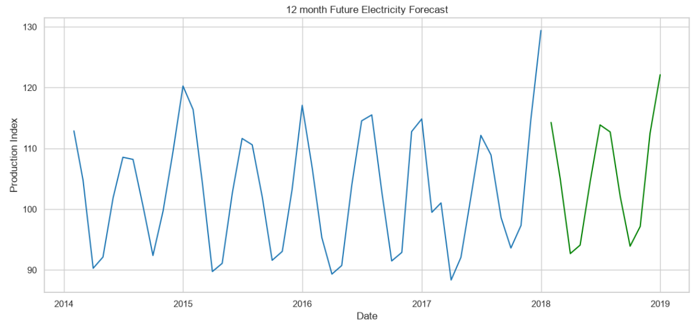

⚡ Electricity Production Forecasting Project

📖 About This Project

Have you ever wondered how electricity companies know how much power will be needed next month or next year?

This project helps answer that question by analyzing over 30 years of historical electricity production data and using it to predict future electricity demand. By understanding past patterns and seasonal trends, we can estimate how much electricity may be needed in the future and support better planning and decision-making. 

The goal of this project is not just to build a forecasting model, but to provide a reliable tool that can help energy providers, businesses, and policymakers prepare for future demand. 

🎯 The Problem

Electricity demand changes throughout the year.

Some months require more electricity due to:

Weather conditions
Increased use of heating or cooling systems
Population and economic growth
Seasonal activities
Without accurate forecasting, electricity providers may:

Produce too much energy and waste resources
Produce too little energy and risk shortages
Face higher operational costs
This project aims to predict future electricity production needs using historical data. 

📊 The Data

The dataset contains monthly electricity production records collected between 1985 and 2018, giving nearly 33 years of historical information. 

Dataset Snapshot
The original dataset contains a date column and a production index that measures electricity generation. 

🔍 What We Found During Analysis
1. The Data Was Clean and Reliable
Before making predictions, the data was checked for:

✅ Missing values

✅ Duplicate records

✅ Missing months

✅ Unusual or extreme values

The analysis showed that the dataset was complete and suitable for forecasting. 

2. Electricity Production Follows Seasonal Patterns
One of the most important discoveries was that electricity production follows a repeating yearly cycle.

Certain months consistently show:

Higher production
Higher energy demand
Seasonal peaks
Other months show lower activity.

This pattern repeats year after year, making forecasting possible. 

3. Electricity Production Has Grown Over Time
When we visualized the data over several decades, we observed a general upward trend.

This suggests that electricity demand has increased over time, likely due to:

Population growth
Technological development
Increased energy consumption

📈 How Forecasting Was Performed

The project compared multiple forecasting approaches to determine which provided the most accurate predictions.

Basic Approach
The simplest forecasting method assumes future values will behave similarly to recent historical values.

While useful as a starting point, this approach was not sufficiently accurate. 

Improved Seasonal Approach
A second method incorporated seasonal patterns from previous years.

This significantly improved forecasting performance because it recognized recurring yearly behavior. 

Advanced Forecasting Model
Finally, an advanced forecasting model (SARIMA) was trained to learn:

Long-term trends
Seasonal patterns
Historical behavior over time
This model delivered the best prediction accuracy. 

✅ Results and Visualizations

The final forecasting model was able to predict future electricity production with approximately 97% accuracy, resulting in only about 3% forecasting error. 

This means the model can reliably estimate future electricity production requirements while accounting for expected seasonal fluctuations. 

🔮 Future Forecast

After learning from more than three decades of electricity production history, the model generated forecasts for the next 12 months. 
The forecasts suggest that:

Seasonal patterns are expected to continue.
Higher production periods will likely remain consistent.
Overall demand remains stable with expected fluctuations throughout the year.
These forecasts can help organizations make informed planning and operational decisions. 

💼 Business Value

This forecasting solution can be useful for:

Energy Providers

Plan electricity generation more efficiently.

Utility Companies

Manage infrastructure and resources proactively.

Government Agencies

Support energy policy and long-term planning.

Businesses

Prepare for changes in energy demand and costs.

🚀 Key Takeaways

Over 30 years of electricity production data were analyzed. 
Strong yearly patterns were identified.
Electricity production generally increased over time.
The forecasting model achieved approximately 97% prediction accuracy.
A 12‑month forecast was successfully generated to support future planning. 【1-85d980】

👨‍💻 Author
Samsondeen Kazeem

Data Scientist | Machine Learning Engineer
